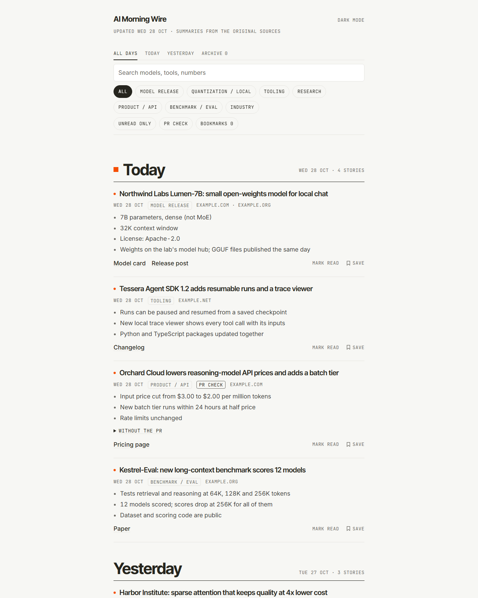

# AI Morning Wire

A short AI-news digest that is waiting for you every morning. Each story is a few bullet points of hard facts (model sizes, prices, licenses, benchmark scores) with links to the primary sources, and, when a company's own announcement oversells its news, a "Without the PR" reading that says what the source actually shows.

It runs on your own PC through [Claude Code](https://claude.com/claude-code): a scheduled task opens Claude Code each morning, which collects stories, summarizes them, checks every number against the saved source pages and rebuilds one local web page. It costs nothing beyond the Claude plan you already have.

It is for a somewhat technical person who already uses Claude Code on Windows and wants a quick daily check-in with links to the originals, not a feed to scroll.



The screenshot is built from an invented sample day, not from real third-party content.

## Requirements

- Windows 10 or 11 (Windows only for now).
- Python 3.11 or newer (the `py` launcher or a real `python`; the Microsoft Store stub does not count). No packages to install.
- [Claude Code](https://claude.com/claude-code), installed and logged in (the `claude` command works in a terminal).
- Windows Terminal (`wt`), which the morning run opens in. It is included with Windows 11.
- [Git for Windows](https://git-scm.com/download/win), to clone the repository. The morning session also runs its commands in its Git Bash.

Setup checks all of this and says exactly what is missing and how to fix it.

## Setup

```powershell
git clone https://github.com/NoCritics/ai-morning-wire
cd ai-morning-wire
powershell -ExecutionPolicy Bypass -File setup.ps1
```

Setup asks a few questions, each with a default (taken from `config.toml` when one exists, else the public defaults): the time of the digest (08:00), whether to also publish a private claude.ai page, and whether to turn on any opt-in source or the browser fallback (each shows its terms warning first). Then it:

1. writes `config.toml` (kept out of git) and `.claude/settings.local.json` (the allow rules for the Python commands of this folder, also out of git);
2. prints the exact `Register-ScheduledTask` command and registers the scheduled task only after you say yes;
3. after registering, runs the **first run**, which is required, not optional (if you decline to register, setup only prints the command to run it later).

The first run is interactive. A new Windows Terminal window opens and builds today's digest. Watch it and accept Claude Code's "trust this folder" prompt once: Claude Code ignores the allow rules of this folder until you do, and a scheduled run would otherwise stall on that prompt. If you turned on the claude.ai page, approve the page's database capability once on its first publish too. After that the morning runs need no prompts.

Options: `-TaskName <name>` (default: the `task_name` in `config.toml`, else "AI Morning Wire"), `-Time HH:MM`, `-Defaults` (answer every question with its default: those of an existing `config.toml`, else all opt-ins off), `-Yes` (approve every confirmation except replacing an existing `config.toml`, which only an interactive yes does) and `-DryRun` (print every check, file and command and change nothing).

Updating is `git pull`. To change `time`, `python`, `browser_fallback` or `claude_ai_page`, or after moving the folder, run `setup.ps1` again (`-Time HH:MM` to change the time) so the task and the allow rules point at the right places, and watch the next morning's run. When you keep an existing `config.toml`, the task uses its `time`; if you pass a different `-Time`, setup rewrites only the `time` line of the kept file and says so. Editing `time` by hand does not move the scheduled task, and editing `browser_fallback` or `claude_ai_page` by hand does not add the allow rules those features need, so the next morning would stall on permission prompts. After moving the folder, run `claude` once in the new location and accept its "trust this folder" prompt (setup's first run does this when it opens a window).

## What a morning looks like

At the chosen time the scheduled task opens Claude Code in a new Windows Terminal window in this folder, on Sonnet, with the runbook ([docs/daily-run.md](docs/daily-run.md)) as its prompt. The run collects, summarizes, checks, builds and, if you turned it on, publishes. It leaves a short report in that window, which stays open as the visible result; closing it ends the session. Nothing runs between mornings.

The page is `ai-news.html` in this folder. Open it in any browser. If the PC is asleep at the chosen time, the task asks Windows to wake it; many laptops don't wake for it (Modern Standby, or on battery), and then the run starts as soon as you wake the PC. If it was off, the run starts after you log on. It runs only while you are logged on.

The private claude.ai page is a small page that loads one file per day, so each morning's publish stays small however long the history grows. The local `ai-news.html` holds everything in one file.

A run never fails silently. Every run ends with a line in `data/runs.log` (`published: ...` or `failed: <reason>`), and a day with no digest says why on the page. A second trigger 95 minutes after the chosen time (and one at logon) closes a run that is more than 90 minutes old and never finished, and shows it as failed; if the PC was asleep or off at that moment, the run is closed at the next wake-up or logon instead. It retries once only when every source was unreadable, and only when that second trigger falls on the same day: with a chosen time after about 22:25 it falls after midnight, and then the retry happens only at a logon.

Zero new stories is a normal result (Daily Papers is empty on weekends); the page then says so.

## Sources and their terms

This is a reading of each source's terms, checked on 2026-10-27. It is not legal advice. Decide for yourself, and read the terms yourself before turning an opt-in source on.

- **Hacker News** (through the Algolia HN Search API) and **Hugging Face Daily Papers** (public API): public APIs offered for this kind of use. On by default.
- **AlphaSignal**: its [terms](https://alphasignal.ai/terms) section 6 forbid "robot, spider, scraper, crawler, or other automated means" without prior written permission, and section 7.2 grants access for "personal, non-commercial use". Its `robots.txt` allows all crawlers, including Claude's agents, with `ai-input=yes`. The collector reads its feed and fetches every article page for the citations, which is the automated access section 6 forbids. Off by default.
- **Telegram** (the public `t.me/s` previews of the channels in `telegram_channels`): its [terms](https://telegram.org/tos) ban data scraping by users and third-party services, and its [content licensing and AI scraping terms](https://telegram.org/tos/content-licensing) forbid "scraping, indexing, harvesting, aggregation or use of data" for AI purposes without the content owners' explicit consent, with no personal-use exception. The collector scrapes the preview and passes each post's first line to the summarizer as a headline. Off by default.
- **Primary sources** (the pages the stories link to): fetched one page at a time, like a reader, saved locally and quoted only as short facts with links. Respect each site's terms. The digest is for your personal reading and is never republished.
- **Browser fallback**: opens pages that refuse the collector (403/429/503, bot checks, JavaScript-only pages) in a real browser, which gets around bot protection, and fetches them again with WebFetch if that fails. Off by default. With it off, a blocked page is skipped and logged, and its story uses its other sources or is left out.

X (Twitter) posts that a story links to are read through fxtwitter's public embed API by default. [twitterapi.io](https://twitterapi.io) is used only if you set your own `TWITTERAPI_IO_KEY` environment variable.

## The opt-in settings

Everything is in `config.toml`, created by setup from [config.example.toml](config.example.toml). Every key is optional.

| Key | Default | What it does |
|---|---|---|
| `time` | `"08:00"` | When the scheduled task starts (24-hour HH:MM). Change it by rerunning `setup.ps1 -Time HH:MM`; editing it by hand does not move the task, and the task could then fire before the time you set. |
| `max_stories_per_day` | `25` | Most stories kept per day, across all sources. |
| `browser_fallback` | `false` | Let a real browser fetch blocked pages. Needs the Playwright MCP server in your Claude Code. See the terms above. Change it by rerunning `setup.ps1`, which writes the allow rules it needs. |
| `claude_ai_page` | `false` | Also publish the digest as a private claude.ai page. Change it by rerunning `setup.ps1`, which writes the allow rules it needs. |
| `python` | set by setup | Full path to `python.exe`, used by the task and in the allow rules. Empty falls back to `py -3`. Rerun `setup.ps1` after changing it. |
| `claude` | set by setup | Full path to `claude.exe`, used in the scheduled task's launch command written by setup. |
| `task_name` | `"AI Morning Wire"` | The default Task Scheduler task name the next time you run `setup.ps1` (without `-TaskName`). |
| `[sources] hacker_news`, `daily_papers` | `true` | The two sources that are on by default. |
| `[sources] alphasignal`, `telegram` | `false` | The opt-in sources. See the terms above. |
| `[sources] telegram_channels` | `["neuraldvig", "whackdoor"]` | Channels read when `telegram` is on. |
| `[sources] hacker_news_max`, `daily_papers_max` | `12`, `8` | Most Hacker News and Daily Papers stories picked per day. |

Setup shows the AlphaSignal, Telegram and browser-fallback warnings when you turn one on. You can edit the other keys (the caps and the `[sources]` table) by hand at any time. For `time`, `python`, `browser_fallback` and `claude_ai_page`, rerun `setup.ps1` and watch the next run: the task and the allow rules are written only by setup.

### What the unattended run is allowed to do

The morning session must never stall on a permission prompt, so this folder ships a project settings file, `.claude/settings.json`, and setup writes the rules that depend on your machine and your choices to `.claude/settings.local.json` (out of git). Nothing is written to your global `~/.claude/settings.json`.

- **Always allowed:** the folder's scripts (`collect.py`, `summarize.py`, `assemble.py`, `build.py`, `runstate.py`) run with your interpreter, spelled exactly as the runbook types them in the Bash tool (a quoted path with forward slashes), and reading the date.
- **Turned off:** Claude Code's PowerShell tool, so every command runs through the Bash tool (Git Bash). On some PCs (for example with PowerShell 7 from the Microsoft Store) the PowerShell tool fails its own command check and asks before every command, whatever the allow rules say, which would stall the unattended run.
- **Only with `browser_fallback` on:** `browser_source.py` (which refuses any file outside `work/<date>/sources/<story>/`), WebFetch, and exactly four Playwright tools (navigate, wait for, evaluate and close) of the server setup detects, never the server's other tools.
- **Only with `claude_ai_page` on:** the Artifact and ArtifactData tools and the two artifact skills. Deleting or pinning a page and every ArtifactData write (set, update, delete or batch) stay denied in `.claude/settings.json` either way.
- **Always denied:** editing Python and PowerShell files, `scripts/`, `template/`, `.claude/`, `docs/`, `README.md`, the config files and instruction files (`CLAUDE.md` and `CLAUDE.local.md` at any depth, so none can be planted for later sessions), so the session can write its own run files (`work/`, `data/`) but not change the code it runs.

**What protects the run from hostile web pages.** The unattended session reads untrusted text: story titles, and, when it fixes a number, source text; with the browser fallback on it also reads the output of the browser and WebFetch. It can write files and run commands, so it is not isolated from that text. What limits the damage: the summarizer that reads every source in full is the read-only `news-summarizer` agent (Read, Grep and Glob, no MCP servers); the session's commands are limited to the allow list above, and the runbook tells it to run nothing else; the deny rules protect the code files; and every number in the digest is checked against the saved sources by `assemble.py`. This reduces the risk, it does not remove it. Keep the browser fallback off if you do not want the session to fetch arbitrary pages.

## What it costs

Nothing beyond your Claude plan. The morning session and the summarizer both use your plan's usage, and every Claude process in a run uses Sonnet. `max_stories_per_day` caps the work (stories are summarized in batches of 3 to 4, at most 3 batches in parallel). Lower it, or turn sources off, if you want to use less.

## Customize the page

Both pages are built from [template/page.html](template/page.html), [template/page.css](template/page.css) and [template/page.js](template/page.js). The colors and fonts are CSS variables on `:root` at the top of `template/page.css`:

```css
/* excerpt: the light-theme values; --focus-surface and --on-ink are also defined */
:root {
  --canvas: #f7f7f4;   /* page background */
  --ink: #26251e;      /* headings */
  --body: #3d3d3a;     /* running text */
  --muted: #6c6a64;    /* labels and dates */
  --hairline: #e6e5e0; /* row dividers */
  --accent: #f54e00;   /* unread dots and the Today marker */
  --font-display: "Inter Tight", "Inter", system-ui, sans-serif;
  --font-body: "Inter", system-ui, sans-serif;
  --font-mono: "JetBrains Mono", ui-monospace, Consolas, monospace;
}
```

There is a second set for dark mode (the page follows the system theme and has a toggle). After editing, run `py -3 build.py` to rebuild `ai-news.html` and the claude.ai page in `work/publish/` (both come from the same template files).

## Uninstall

```powershell
powershell -ExecutionPolicy Bypass -File uninstall.ps1
```

It shows the exact `Unregister-ScheduledTask` command and removes the task only after you say yes (`-TaskName <name>` if you used another name, `-Yes` to skip the question). It never deletes files: it prints the folder, which also holds your `config.toml` and `data/`, so you can delete it yourself.

## How it works

1. **Collect** (`collect.py`): finds stories from the sources you enabled, drops duplicates and anything already published, caps the day at `max_stories_per_day`, and saves each story's primary-source pages under `work/<date>/`.
2. **Summarize** (`summarize.py`): the stories go in batches to the read-only `news-summarizer` agent (`.claude/agents/news-summarizer.md`), run headless with Read, Grep and Glob only. Source files are untrusted web pages, so nothing that can write, run commands or browse ever reads them.
3. **Check** (`assemble.py`, `ainews/verify.py`): every item is checked against its saved sources. A number that is not in the sources, a source that was never read, or a "Without the PR" pitch that is not quoted word for word sends the item back for a fix.
4. **Build** (`build.py`): validates the data and writes `ai-news.html`, and also the small claude.ai page and its side files in `work/publish/`, keeping the last 7 days in the feed and 30 days in the archive.

The runbook that Claude Code follows each morning is [docs/daily-run.md](docs/daily-run.md).

## Limitations

- Windows only.
- Claude Code is required, and a Claude Code window opens each morning; closing it ends the run.
- It runs only while you are logged on.
- The digest is only as complete as its sources: with the defaults it reads Hacker News and Daily Papers, so quiet days and weekends have fewer stories.
- The summarizer is a language model. The number checks catch numbers that are not in the sources, not every misreading, so follow the links for anything that matters.
- Stories behind bot protection are skipped unless you turn the browser fallback on.

## Roadmap

Later releases, in this order of likelihood:

- Your own sites or journals as sources, added to or replacing the defaults.
- Sending the digest by email or to a channel of your choice.
- An API edition (Python calling the Messages API, no terminal needed).
- Mac and Linux.
- Codex and agy versions, and a Claude Code plugin wrapper.
- A desktop-app edition.

## License

[MIT](LICENSE).
